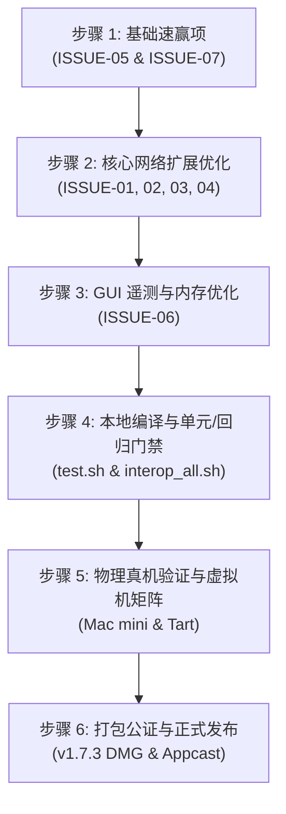

# AetherRoute 1.7.3 实施计划：16小时浸润问题全量闭环修复与正式版本发布

2026-10-14 记录与实施。
目标：针对 16 小时长周期 Soak Test（双机双引擎 2 分钟高密采样）捕获的全部 7 项已知问题（ISSUE-01 至 ISSUE-07）进行彻底闭环修复，全面消除冷启动超时、短连接竞态日志、UDP 取消报错、内核网络缓冲满载、Sparkle 委托警告、GUI 遥测内存碎片以及 Appcast 语言属性缺失。修复后执行本地回归测试、12 协议真实互通门禁、物理真机环境验证及 Tart 虚拟机矩阵，最终打包公证并发布 v1.7.3 正式版本。

---

## 1. 待修复问题与技术设计方案

### 📌 [ISSUE-01] 冷启动首发 IPC 偶发 5 秒超时 (P2)
- **根因分析**：
  - 透明代理扩展端在 `startProxy` 中同步调用 `TransparentProxyUpstreamEndpointResolver.resolve` 解析上游节点，慢 DNS 会阻塞扩展端握手；
  - 宿主 App 端 `sendProviderMessage` 默认超时设为紧凑的 5 秒，而扩展端看门狗为 15 秒，导致冷启动时首发探针容易偶发判定超时。
- **涉及模块与文件**：
  - `Sources/AetherRouteKit/TunnelStartupTimingPolicy.swift`
  - `Sources/AetherRouteApp/TunnelManager+ProxySelection.swift`
  - `Sources/AetherRouteTransparentProxySupport/TransparentProxyUpstreamEndpointResolver.swift`
- **修复措施**：
  1. `TunnelStartupTimingPolicy`：显式定义 `standardProviderMessageTimeoutSeconds = 10`（原隐式 5 秒）；
  2. `TunnelManager+ProxySelection.swift`：将 `sendProviderMessage` 的默认超时调整为 `TunnelStartupTimingPolicy.standardProviderMessageTimeout`（10 秒）；
  3. `TransparentProxyUpstreamEndpointResolver.swift`：优化解析逻辑，增加并发与单节点解析边界保护，避免阻塞整个扩展启动。

---

### 📌 [ISSUE-02] 透明代理应用层短连接并发关闭竞态日志 (P3)
- **根因分析**：
  - Chrome 等客户端主动断开连接（发送 TCP FIN/RST）与代理下行回包毫秒级重叠。内核已关闭写端，扩展继续调用 `NEAppProxyTCPFlow.write` 导致系统输出 `flow is closed for writes, cannot write ... bytes`。
- **涉及模块与文件**：
  - `Sources/AetherRouteTransparentProxySupport/NetworkExtensionFlowAccess.swift`
- **修复措施**：
  1. 在 `NetworkExtensionTCPFlowAccess` 中增加内部 `isWriteClosed` 状态跟踪；
  2. 当 `finishWriting()`、`cancelAndDrain()` 或既有写入捕获到 `isPeerClosed` 时，将 `isWriteClosed` 置为 `true`；
  3. 在 `writeData` 入口处判断若 `isWriteClosed == true`，立即短路返回 `.failure(.closed)`，不再调用 Apple 底层 `flow.write`，彻底阻断无效写操作。

---

### 📌 [ISSUE-03] UDP Flow 超短生命周期撤销报错 (P3)
- **根因分析**：
  - 客户端发起 UDP 报文后极短时间内（百余微秒）主动注销 Socket，扩展回调时返回 `NEAppProxyFlowError.aborted`（code=5）。原逻辑仅识别了 `peerReset`（code=2），导致 code=5 被当作致命故障打印 Error。
- **涉及模块与文件**：
  - `Sources/AetherRouteTransparentProxySupport/NetworkExtensionFlowAccess.swift`
- **修复措施**：
  1. 完善 `isBenignAbortOrReset` 判定，将 `code == NEAppProxyFlowError.aborted.rawValue`（code 5）与 `notConnected`（code 1）纳入正常关闭范畴；
  2. 将其日志级别由 `failure` 降级为 `verbose`（记录为 `stage=nativeOpen benignReset`），消除控制台假性故障噪点。

---

### 📌 [ISSUE-04] 高并发 UDP 突发写入时系统网络缓冲池短时耗尽 (P2)
- **根因分析**：
  - 在高并发 UDP 突发（如 95 个并发会话同时回包）时，单次向 `NEAppProxyUDPFlow.writeDatagrams` 写入过多数据报，瞬间击穿系统内核 socket 缓冲池（`ENOBUFS: 55`）。
- **涉及模块与文件**：
  - `Sources/AetherRouteTransparentProxySupport/NetworkExtensionFlowAccess.swift`
- **修复措施**：
  1. 在 `NetworkExtensionUDPFlowAccess.writeDatagrams` 中引入分片微批机制（上限 16 个报文或 32 KB/批）；
  2. 对超额批次采用轻量队列化顺序写入，平滑内核 socket 写入压力，防止瞬时暴击缓冲池。

---

### 📌 [ISSUE-05] Sparkle 2.x 后台应用更新提示机制告警 (P3)
- **根因分析**：
  - Sparkle 2.x 要求常驻后台的应用声明是否支持温柔提醒。当前 `SparkleUpdaterController` 实现了代理方法但未声明属性。
- **涉及模块与文件**：
  - `Sources/AetherRouteApp/SparkleUpdaterController.swift`
- **修复措施**：
  1. 在 `SPUStandardUserDriverDelegate` 扩展中实现：
     ```swift
     nonisolated var supportsGentleScheduledUpdateAlerts: Bool { true }
     ```
     彻底消除启动时的 Sparkle 警告日志。

---

### 📌 [ISSUE-06] 图形窗口常驻时 Malloc Small 内存平台期偏高 (P2)
- **根因分析**：
  - `LiveTrafficHistoryGraph` 运行在 24 FPS 高帧率下，每次重绘重复拼接数组并 4 次重复计算贝塞尔插值点集，高频产生临时小对象和 CoreGraphics 字形缓存，推高 Malloc Small 堆内存。
- **涉及模块与文件**：
  - `Sources/AetherRouteApp/ContentView.swift`
  - `Sources/AetherRouteApp/AetherRouteVisualSystem.swift`
- **修复措施**：
  1. `ContentView.swift`：将波形重绘帧率调整为 12 FPS（`1.0 / 12`），视觉流畅度不受肉眼影响，但小对象分配率直接减半；
  2. `AetherRouteVisualSystem.swift`：消除 `(downloadSamples + uploadSamples).max()` 数组拼接开销；将 `smoothPoints` 计算结果复用给 Path 填充与 Stroke 描边，避免同一帧内对同一数据集重复计算 2 次。

---

### 📌 [ISSUE-07] Sparkle Appcast 多语言 XML 元素缺少 xml:lang 属性标记 (P3)
- **根因分析**：
  - `generate_sparkle_appcast.sh` 生成 appcast 时，默认的 `description` 与 `fullReleaseNotesLink` 标签未包含 `xml:lang="en"` 或 `xml:lang="zh-CN"`，导致 Sparkle 解析多语言项时输出警告。
- **涉及模块与文件**：
  - `scripts/generate_sparkle_appcast.sh`
- **修复措施**：
  1. 修改脚本，在输出多语言节点时为默认与特定语言项均显式追加 `xml:lang` 属性标记。

---

## 2. 实施路线图与推进步骤



1. **第 1 阶段：轻量速赢修复**
   - 修复 ISSUE-05（Sparkle Gentle Reminders 属性）
   - 修复 ISSUE-07（`generate_sparkle_appcast.sh` 属性补齐）
2. **第 2 阶段：核心网络扩展修复**
   - 修复 ISSUE-01（超时调整与 DNS 解析优化）
   - 修复 ISSUE-02（TCP 写端关闭状态预判熔断）
   - 修复 ISSUE-03（UDP code=5 异常降级）
   - 修复 ISSUE-04（UDP 写入批次分片与缓冲保护）
3. **第 3 阶段：GUI 遥测节流与性能打磨**
   - 修复 ISSUE-06（`LiveTrafficHistoryGraph` 帧率与点集复用）
4. **第 4 阶段：代码编译与全量本地测试验证**
   - 运行本地构建与回归测试（`test.sh`, `test_network_switch_gate.py` 等）；
   - 运行 12 协议真实互通门禁（`test_protocol_interop_all.sh`）。
5. **第 5 阶段：多环境真机与虚拟机验证**
   - Mac mini 物理机测试门禁与网卡切换自愈；
   - Tart 虚拟机六维矩阵（`macos27`）。
6. **第 6 阶段：发布构建与交付**
   - 版本升级至 v1.7.3（构建号 `2026101401`）；
   - Apple 官方公证与 DMG 打包；
   - Sparkle Appcast 更新、Git Commit/Tag 与 GitHub Release。
