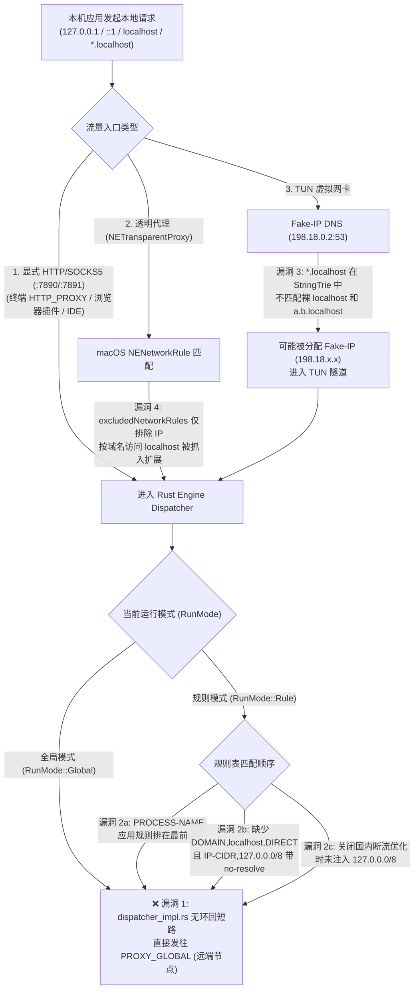

# AetherRoute for macOS `v2.4.1` 详细技术方案：对标主流客户端的本地环回（`127.*` / `::1` / `localhost`）防代理泄漏五层纵深防御

> [!IMPORTANT]
> **核心问题本质**：本地环回地址（`127.0.0.0/8`、`::1/128`、`localhost`、`*.localhost`）代表**当前物理本机自身**。一旦代理客户端把目标为 `127.0.0.1` 或 `localhost` 的请求转发给远端代理节点，远端服务器会去连接**代理节点自己机器上的 `127.0.0.1`**，不仅会导致本机开发服务（Vite / Next.js / Webpack、Cursor / VS Code 语言服务、本地 MCP Server、Ollama、Docker 端口映射、本地 OAuth 回调）100% 断联或返回错误内容，还会构成环回 SSRF 安全风险。

---

## 一、主流客户端（Surge 5 / Clash Verge Rev (Mihomo) / Stash）处理机制深度对比

我们对 **Surge 5 for Mac**、**Clash Verge Rev (Mihomo 内核)**、**Stash for macOS** 在「全局模式（Global）」、「规则模式（Rule）」、「应用分流（Process Rule）」、「本地混合代理端口（HTTP/SOCKS5）」与「TUN / 透明代理」下的处理机制进行了逐层拆解对比：

| 维度 / 场景 | Surge 5 for Mac | Clash Verge Rev (Mihomo) | Stash for macOS | AetherRoute 当前 (`v2.4.0`) | `v2.4.1` 对齐目标 |
| :--- | :--- | :--- | :--- | :--- | :--- |
| **1. 全局模式 (`Global`) 下访问 `127.0.0.1` / `::1` / `localhost`** | **强制 `DIRECT`**（内置不可覆盖的环回短路保护，全局模式仅针对非环回流量生效） | **默认 `DIRECT`**（系统代理 Bypass 列表 + 内核 Loopback 保护 + Fake-IP 跳过 `+.localhost`） | **强制 `DIRECT`**（底层网络栈与代理入口直接短路环回地址） | ❌ **走远端代理 `GLOBAL`**（`dispatcher_impl.rs` 在 `RunMode::Global` 下无环回短路） | ✅ **内核级无条件短路 `DIRECT`**（无论 Global / Rule 均永不发往远端节点） |
| **2. 规则模式 (`Rule`) + 应用分流规则 (`PROCESS-NAME,App,Proxy`)** | **环回优先 `DIRECT`**（哪怕给 Chrome / Cursor 配置了强制走代理，该应用访问 `127.0.0.1` 依然直连本机） | **环回规则置顶或跳过**（本地环回不因进程名规则而发往远端节点） | **环回优先 `DIRECT`** | ❌ **走远端代理**（`DomesticRoutingOptimizer.swift` 将 `PROCESS-NAME` 排在 `127.0.0.0/8` 之前） | ✅ **环回保护规则绝对置顶**（高于一切 `PROCESS-NAME`、自定义规则与远程规则集） |
| **3. 规则模式 (`Rule`) 下访问 `http://localhost:端口`（按域名请求 `:7890`）** | **强制 `DIRECT`**（内置 `localhost` / `*.localhost` 直连） | **内置 `hosts` + `fake-ip-filter` `+.localhost`**，解析为 `127.0.0.1` 后匹配 `127.0.0.0/8` 直连 | **强制 `DIRECT`** | ❌ **走远端代理**（缺少 `DOMAIN,localhost,DIRECT` 与 `DOMAIN-SUFFIX,localhost,DIRECT`，且 `IP-CIDR,127.0.0.0/8` 带 `no-resolve` 不触发解析） | ✅ **显式注入 `DOMAIN,localhost,DIRECT` + `DOMAIN-SUFFIX,localhost,DIRECT`** 且内核层直接兜底 |
| **4. 用户关闭「国内断流优化」且订阅未写 `127.0.0.0/8` 规则** | **内置兜底 `DIRECT`** | **内核 + 系统代理 Bypass 兜底** | **内置兜底 `DIRECT`** | ❌ **走远端代理**（`TunnelManager.swift` 跳过 `DomesticRoutingOptimizer`，直接落入 `MATCH,Proxy`） | ✅ **环回保护与国内优化解耦**（无论是否开启国内优化，始终注入环回保护 + 内核兜底） |
| **5. DNS Fake-IP 拦截 (`localhost` / `*.localhost`)** | **`localhost` 永不分配 Fake-IP**（符合 RFC 6761，始终返回 `127.0.0.1` / `::1`） | **`+.localhost` 默认跳过 Fake-IP**，内置 hosts 映射 `127.0.0.1` | **`+.localhost` 永不分配 Fake-IP** | ⚠️ **存在穿透漏洞**（`DomesticRoutingOptimizer.swift` 写的是 `"*.localhost"`，在 `trie.rs` 中仅匹配单级子域，**不匹配裸 `localhost` 和多级 `a.b.localhost`**） | ✅ **升级为 `+.localhost` / `+.local` / `+.lan`**，且在 Rust `FakeDns::should_skip` 中硬编码 RFC 6761 保护 |
| **6. 透明代理 (`NETransparentProxy`) 拦截 `localhost` 域名流** | **在 NetworkExtension 规则层直接 Bypass** | 不使用 `NETransparentProxy` | **在 NetworkExtension 规则层直接 Bypass** | ⚠️ **仅按 IP 排除 `127.0.0.0/8`、`::1/128`**（`TransparentProxyProvider.swift` 未排除 `localhost` 主机名端点，导致按域名发起的连接先被抓进扩展） | ✅ **`excludedNetworkRules` 同时排除 IP (`127.0.0.0/8`, `::1/128`) 与主机名 (`localhost`, `local`)** |
| **7. 自定义 Hosts / 内网 DNS 解析出 `127.0.0.1` 的域名** | **解析出环回 IP 后自动走 `DIRECT`** | **DNS 解析出 `127.0.0.1` 后匹配 `127.0.0.0/8,DIRECT`** | **解析出环回 IP 后自动走 `DIRECT`** | ❌ **若命中前置域名代理规则或全局模式，即使 `resolved_ip` 是 `127.0.0.1` 也会发往远端节点** | ✅ **`Dispatcher` 检查 `sess.destination` 与 `sess.resolved_ip`，凡是环回 IP 一律短路 `DIRECT`** |

---

## 二、AetherRoute 当前 5 处根因链路图解

---

## 三、`v2.4.1` 五层纵深防御改造方案（对齐主流客户端最佳实践）

### 第 1 层：Rust 核心引擎 `Dispatcher` 无条件环回直连短路（最底层绝对防线）
- 在 `Core/Engine/clash-lib/src/app/dispatcher/dispatcher_impl.rs` 新增环回检测，对目标地址或解析后 IP（`sess.resolved_ip`）属于 `127.0.0.0/8`、`::1`、`0.0.0.0`、`::`、`localhost`、`*.localhost` 的连接，一旦路由决策试图将其发往远端代理节点（即非 `DIRECT` 且非 `REJECT`），无论处于 `RunMode::Global` 还是 `RunMode::Rule` 均强制短路为 `PROXY_DIRECT`。

### 第 2 层：Rust DNS 与 Fake-IP 层内置 RFC 6761 环回保护
- 在 `Core/Engine/clash-lib/src/app/dns/fakeip/mod.rs` 的 `FakeDns::should_skip` 中硬编码跳过 `localhost` 与 `*.localhost`。
- 在 `Core/Engine/clash-lib/src/app/dns/config.rs` 的默认 `hosts` 树中内置 `localhost` 与 `+.localhost` -> `127.0.0.1`，并在 `SystemResolver` 中为 `localhost` / `*.localhost` 提供内置环回解析。
- 在 `Sources/AetherRouteKit/DomesticRoutingOptimizer.swift` 的 `fakeIPFilterDomains` 中将 `"*.lan"`、`"*.localdomain"`、`"*.local"`、`"*.localhost"` 升级为 `"+.lan"`、`"+.localdomain"`、`"+.local"`、`"+.localhost"`。

### 第 3 层：Swift 配置重写与规则表最高优先级置顶（高于 `PROCESS-NAME` / `AETHER-APP` 应用规则）
- 在 `DomesticRoutingOptimizer.swift` 中定义 `loopbackProtectionRules`（`DOMAIN,localhost,DIRECT`、`DOMAIN-SUFFIX,localhost,DIRECT`、`IP-CIDR,127.0.0.0/8,DIRECT,no-resolve`、`IP-CIDR6,::1/128,DIRECT,no-resolve`），排在一切应用分流规则与自定义规则之前；且即使关闭「国内断流优化」也始终注入该环回保护。

### 第 4 层：macOS 透明代理（`NETransparentProxy`）内核级排除强化
- 在 `TransparentProxyProvider.swift` 的 `makeNetworkSettings` 中，除 `127.0.0.0/8` 和 `::1/128` IP 段排除外，默认追加 `"localhost"` 与 `"local"` 主机名排除规则。

### 第 5 层：UI「路由测试器」与「6 步连接分流追踪」一致性对齐
- 在 `ConnectionAndDNSInspector.swift` 与 `ProfileConfigurationSummary.swift` 中同步环回地址最高优先级 `DIRECT` 判定逻辑。
